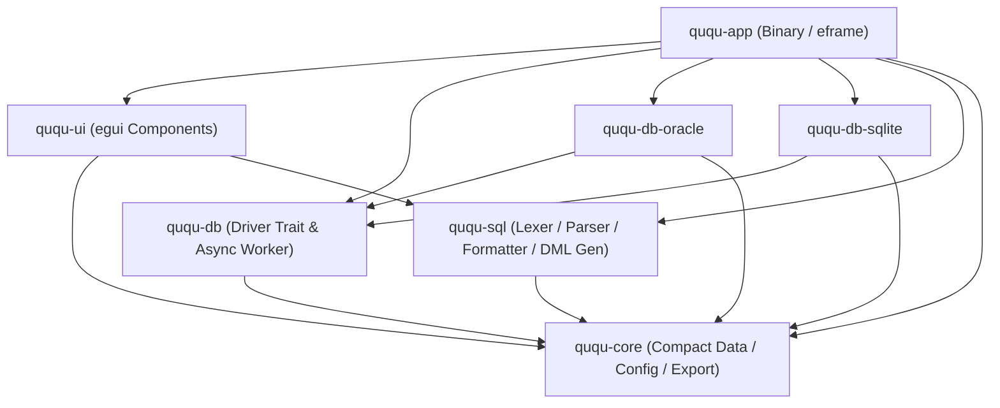

# QuQuSQL アーキテクチャ・マルチクレート設計書

## 1. マルチクレート構成の採用理由

QuQuSQL は単一クレートではなく **Cargo Workspace によるマルチクレート構成** を採用します。

1. **インクリメンタルビルドの高速化**: UI（`egui`）の微調整時に、重い DB ドライバや SQL パーサを再コンパイルせずに済む。
2. **責務の厳格な分離（パフォーマンス保証）**: `egui` はイミディエイトモード GUI のため、UI クレートにデータ本体や DB 接続ロジックを混在させると毎フレームの描画コストが増大する。コアデータ構造と UI 描画層をクレート境界で分離する。
3. **Feature Flags によるバイナリ・メモリ最適化**: 必要な DBMS ドライバだけを有効化してビルド可能にし、起動時間とフットプリントを最小限に抑える。
4. **ヘッドレス単体テスト**: UI を起動せず、`ququ-core` / `ququ-sql` / `ququ-db` 単位で SQL 分割・補完・差分 UPDATE 生成・CSV パースの高速テストを実行可能にする。

---

## 2. Cargo Workspace クレート構成

```text
QuQuSQL/
├── Cargo.toml                  # Workspace 定義・共通依存・リリース最適化プロファイル
├── Docs/                       # 設計書・仕様書群
└── crates/
    ├── ququ-core/              # ドメインモデル・省メモリデータ構造・設定・I/O
    ├── ququ-sql/               # SQL レキサー/パーサ・ハイライト・補完・整形・差分DML生成
    ├── ququ-db/                # DB 抽象化トレイト・非同期ワーカー・セッション管理
    ├── ququ-db-sqlite/         # SQLite ドライバ実装 (rusqlite)
    ├── ququ-db-oracle/         # Oracle ドライバ実装 (Pure Rust: oracle-rs)
    ├── ququ-ui/                # egui UI コンポーネント (エディタ・仮想グリッド・ブラウザ)
    └── ququ-app/               # バイナリエントリポイント (eframe 起動・状態統合)
```

### クレート依存関係図



> [!IMPORTANT]
> `ququ-ui` は `ququ-db` に直接依存しません。UI はコマンド（`AppCommand`）を発行し、`ququ-app` が非同期ワーカー（`ququ-db`）へ橋渡しして結果データ（`ququ-core` の型）を UI に渡す **単方向データフロー** を採用します。これにより UI スレッドのブロッキングを構造的に防止します。

---

## 3. 各クレートの責務詳細

### 3.1 `ququ-core`
- **省メモリ結果セット (`ResultSet`)**:
  - 行ごとの `Vec<HashMap<String, String>>` のような重い構造は**禁止**。
  - 列メタデータ（`Vec<ColumnMeta>`）を 1 回だけ保持し、セル本体は **フラットな 1 次元配列 `Vec<CellValue>`**（インデックス = `row * col_count + col`）または列指向チャンクで保持し、ポインタオーバーヘッドとヒープ断片化を最小化。
- **コンパクトセル型 (`CellValue`)**:
  - `Null`, `Bool(bool)`, `Int(i64)`, `Float(f64)`, `Decimal(CompactString)`, `Text(CompactString)`, `Bytes(Arc<[u8]>)` 等で表現。
  - **Oracle `NUMBER` 精度保証**: 16 桁以上の数値 ID や金額が `f64` で丸められないよう、`Decimal(CompactString)` として厳密保持する。
  - 24 バイト以下の短い文字列はインライン格納（`compact_str` クレート活用）し、大量セル取得時のヒープアロケーションを劇的に削減。
- **グリッド差分モデル (`GridPatch` / `RowEditState`)**:
  - 元データ（`ResultSet`）はイミュータブルまたは共有参照とし、編集差分だけをスパースなマップ（`(row_idx, col_idx) -> CellValue`、追加行リスト、削除行セット）で管理。これにより 10 万行中 3 セル編集してもメモリ増加は数 KB に抑えられる。
- **エンコーディング & エクスポート**:
  - `encoding_rs` を用いた Shift_JIS / EUC-JP / UTF-8 の高速自動判別・変換。
  - CSV / TSV（RFC 4180＋Excel 互換改行エスケープ）のストリーミング読み書き。
  - **テーブル仕様書ジェネレータ**: 複数テーブルのメタデータ（カラム・インデックス・制約・コメント）から、Pure Rust の **`rust_xlsxwriter`** を用いた Excel（`.xlsx`）定義書および Markdown（`.md`）定義書を高速生成。
- **接続プロファイル・設定**:
  - TOML 形式での軽量設定保存、環境識別カラー設定、`tnsnames.ora` パーサ。

### 3.2 `ququ-sql`
- **高速 SQL レキサー（インクリメンタル対応）**:
  - シンタックスハイライト用の軽量トークナイザ。行単位のステートキャッシュ（複数行コメント `/* ... */` の継続状態）を持ち、大きな SQL ファイルでも画面内の可視行のみトークン化して描画。
- **スクリプト文分割（Statement Splitter）**:
  - 文字列リテラル・コメント・PL/SQL ブロック（`BEGIN ... END;` / `/` 区切り）を正しく認識した上で、カーソル位置の 1 文抽出および連続実行用の文分割を行う。
- **バインド変数抽出**:
  - `:name` 形式を文字列・コメント外から正確に抽出。
- **文脈補完エンジン**:
  - カーソル周辺のトークンと `FROM` / `JOIN` 句のテーブル・エイリアス対応表を軽量解析し、`SchemaCache` と照合して補完候補を O(1)〜O(log N) で返す。
- **安全な差分 DML ジェネレータ**:
  - `GridPatch` とテーブルメタデータ（主キー or `ROWID` / `ctid`）から、**変更されたカラムのみ**を更新するパラメータ化 `UPDATE` / `INSERT` / `DELETE` 文およびプレビュー用 SQL 文字列を生成。
- **SQL フォーマッタ**:
  - 軽量な独自または `sqlformat` ベースの整形機能。

### 3.3 `ququ-db` およびドライバクレート群
- **統一トレイト設計**:
  - `DbDriver`: 接続確立、対応機能フラグ（`supports_rowid`, `supports_explain_plan`, `supports_dbms_output` 等）の宣言。
  - `DbSession`: クエリ実行（ストリーミング/チャンクフェッチ）、実行キャンセルハンドル、トランザクション制御（`commit` / `rollback`）、メタデータ取得（スキーマ一覧、オブジェクト一覧、カラム・インデックス・制約・トリガ・権限・**DDL 取得**）。
    - Oracle の DDL 取得は `DBMS_METADATA.GET_DDL` を優先し、権限不足エラー時はディクショナリビューから DDL を再構築するフォールバックを備える。SQLite は `sqlite_master` から取得。
- **非同期実行ワーカー（UI 非ブロッキング）**:
  - UI スレッドとは独立した専用ワーカースレッド（または軽量 `tokio` ランタイム）上で DB セッションを保持。
  - 通信は `crossbeam-channel` 等の高速チャネルで `DbRequest` / `DbEvent` をやり取りし、イベント到着時のみ `egui::Context::request_repaint()` を呼ぶ。
  - キャンセル要求時はドライバ固有の `cancel()`（Oracle の `OCI_Break` 相当等）を別スレッドから安全に発行。
- **Oracle ドライバ戦略 (`ququ-db-oracle`) — Pure Rust 方式に確定**:
  - **`oracle-rs`** を採用し、Oracle Instant Client（OCI/ODPI-C DLL）への外部依存を完全に排除した単一バイナリ構成とする。
  - `tokio` ベースのネイティブ非同期通信により、UI スレッドを一切ブロックせず、高速起動・省メモリを実現する。
  - `tnsnames.ora` は `ququ-core` 側のパーサで読み込み、TNS 名から `host / port / service_name (SID)` を解決して `oracle-rs` の `Config` へ渡す。
  - `DbDriver` / `DbSession` トレイト境界は維持するため、万が一将来的に別バックエンドが必要になっても UI・コア層への影響なく差し替え可能。

### 3.4 `ququ-ui`
- **高速 SQL エディタウィジェット（段階移行方式に確定）**:
  - **Phase 1**: `egui::TextEdit` ＋カスタム `Layouter`（シンタックスハイライト）で迅速に MVP を立ち上げ、日本語 IME 入力や基本編集の軽快さを確保。
  - **Phase 3**: 大規模テキスト・矩形選択・行番号・ルーラー・不可視文字の精密描画に対応するため、**`ropey`（Rope データ構造）をバックエンドに持つ独自エディタ**へ移行し、可視行のみ `Galley` を生成・キャッシュして数万行でも 60 FPS を維持。
  - 日本語 IME（`winit` の `Ime::Preedit` / `Ime::Commit`）の候補ウィンドウ位置追従を確実にサポート。
- **超高速仮想グリッドウィジェット（OSqlGrid コア）**:
  - 固定行高による完全仮想スクロール（画面内に見える 30〜50 行 × 可視列のみ描画）。
  - 描画ループ内での `String` ヒープ確保を徹底排除（スタックバッファやキャッシュ済み文字列スライスを利用）。
  - セル選択・範囲選択・キーボードナビゲーション・インライン編集・差分色分けをネイティブ実装。
- **オブジェクトブラウザ＆詳細ペイン**:
  - メタデータはスキーマ単位でキャッシュし、フィルタ入力時はキャッシュに対して即座に絞り込み（DB への無駄な再問い合わせを防止）。

### 3.5 `ququ-app`
- `eframe`（描画バックエンド: **`glow` / OpenGL**）による軽量・高速ネイティブウィンドウ起動とイベントループ管理。
- **1 ウィンドウ ＝ 1 DB セッション** モデルにより、全タブ間で接続・トランザクション状態を一貫管理。
- グローバルアロケータに **`mimalloc`** を採用し、GUI 描画や大量結果セット処理時のアロケーション遅延・メモリ断片化を抑制。
- ウィンドウサイズ・ペイン分割比率・開いていたタブ・接続履歴の高速な保存と復元。

---

## 4. 高速起動・省メモリを実現するための技術戦略

| 課題 | 対策 | 効果 |
| :--- | :--- | :--- |
| **日本語フォントによる起動遅延＆バイナリ肥大** | Windows 環境ではシステム標準の日本語フォント（`BIZ UDGothic` / `Meiryo UI` / `Consolas` 等）をファイルパスから非同期・遅延ロード（フォールバックとして軽量サブセットを用意）。巨大な Noto CJK の `include_bytes!` を避ける。 | 起動時間 200ms 台、バイナリサイズ数 MB に抑制 |
| **イミディエイトモード GUI の CPU 消費** | `eframe` のデフォルトイベント駆動モードを維持し、アニメーションや無意味な `request_repaint()` を一切行わない。 | アイドル時 CPU 0% |
| **大量レコード時のメモリ爆発** | ① フラット配列 `Vec<CellValue>` + `CompactString` ② デフォルトフェッチ上限（例：初期 1,000 行取得＋スクロール末尾で追加フェッチ or 全件取得選択可） ③ 変更差分のみのスパース保持 | 10 万行表示でも低メモリ・即応答 |
| **GPU テクスチャアトラス肥大** | フォントサイズ種類を限定（UI・エディタ・グリッドで統一スケール）、不要なカスタムテクスチャを常駐させない。 | VRAM / RAM 消費の安定化 |
| **リリースバイナリ最適化** | `Cargo.toml` の `[profile.release]` で `lto = "thin"`, `codegen-units = 1`, `strip = true`, `opt-level = 3` を設定。 | 実行速度最大化・バイナリ軽量化 |

---

## 5. 確定した主要技術方針

1. **対応 DBMS（決定済み）**: **Oracle + SQLite** の 2 系統。
2. **Oracle 接続方式（決定済み）**: **Pure Rust 方式（`oracle-rs`）**。Instant Client 不要の単一バイナリ構成。
3. **エディタ実装アプローチ（決定済み）**: **`egui::TextEdit` からの段階移行**（Phase 1 は `TextEdit`＋カスタム `Layouter`、Phase 3 で `ropey` 独自エディタへ移行）。
4. **初期スコープ整理（決定済み）**: PL/SQL 支援・マクロ機能は初期対象外、パスワードは都度入力、デフォルト文字コードは UTF-8、実行計画はインデントテキスト出力。
5. **ターゲット OS（決定済み）**: まずは **Windows 10 / 11 (x86_64)** 対応から開始。
6. **セッション・描画・データ規約（決定済み）**: **1 ウィンドウ ＝ 1 接続**（OSqlEdit 方式）、描画バックエンドは **`glow`**、SQL 区切りは **セミコロン `;`**、初期フェッチ上限 **1,000 行**、`DATE` 表示は **ISO 形式**、`NUMBER` は **厳密保持（`Decimal(CompactString)`）**（詳細は [TODO.md](./TODO.md) を参照）。
