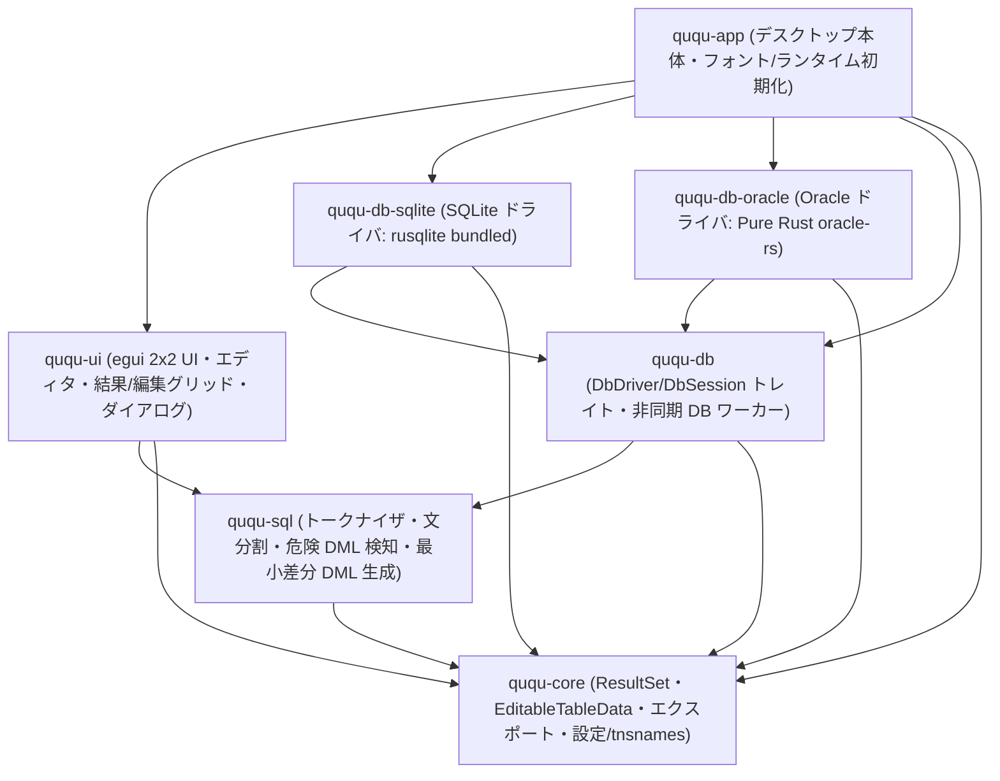

<div align="center">

# ⚡ QuQuSQL

**Rust + `egui` で構築する、超高速・省メモリなネイティブ SQL エディタ＆テーブル直接編集ツール**

[](LICENSE)
[](https://www.rust-lang.org)
[](Cargo.toml)
[](https://github.com/tkshnkgwr/QuQuSQL)

</div>

---

## 背景と開発方針

**QuQuSQL (Quick Query SQL Tools)** は、データベース開発・運用・データメンテナンスの現場で「毎日ストレスなく使える」ことを最優先に設計された、Rust 製デスクトップ SQL クライアントです。

従来の重い Electron / JVM ベースの高機能ツールや、別アプリ間を行き来してログイン再入力・ウィンドウ切替を行う運用から脱却し、**1 つのセッション・1 つのトランザクション上で、SQL 実行からテーブルデータの直接編集までを軽快かつ安全に完結させること**を目指して一から開発しています。

* **開発体制**:
  Rust による設計・実装は、AI（Gemini）と協働しながら進めています。
* **現在のステータス**:
  現在はアルファ版（`v0.0.5-alpha`）です。Phase 1（MVP 基盤・SQL 実行・オブジェクトブラウザ・本番誤操作防止）および Phase 2（テーブル直接編集・`SAVEPOINT` 保護バッチ適用・範囲コピー/集計・Zed 風タブバー）が実装済みです。
* **Pure Rust & 安全第一**:
  Oracle Instant Client を必要としない Pure Rust 接続（`oracle-rs`）と SQLite（`rusqlite` bundled）を採用し、パスワード非保存・手動トランザクション徹底・本番環境ガードを標準で備えています。

---

## 📌 概要

`QuQuSQL` は、**Rust** と **`egui` (`eframe` / `glow`)** によって構築された、単一バイナリ配布可能な軽量 SQL 開発＆データメンテナンスツールです。

高情報密度な **2×2 スプリットペイン** により、一画面で **SQL エディタ・結果グリッド・オブジェクト一覧・カラム詳細・実行ログ** をすべて見渡せる実務特化レイアウトを採用しています。

---

## ✨ 主な特徴

- 🚀 **超高速起動・省メモリ・0% アイドル CPU (`egui` + `mimalloc`)**:
  - ネイティブバイナリと `egui` のリアクティブ描画により、操作時や非同期応答時のみ再描画し、待機時の CPU 使用率 0% を目指した軽量設計です。
  - `ResultSet` を 1 次元フラット配列＋コンパクト型（`CompactString` による高精度 `NUMBER` 保持）で管理し、仮想スクロールにより大量データでも軽快に動作します。
- 🔌 **Instant Client 不要の Pure Rust DB 接続**:
  - **Oracle Database**: Pure Rust ドライバ `oracle-rs` により外部 DLL 依存なしで接続。`tnsnames.ora` の簡易パース、`ROWID` を用いた安全な行特定、メタデータ取得に対応。
  - **SQLite**: `rusqlite` (`bundled`) を同梱し、外部 DB 環境なしでも即座にローカル検証・データ編集が可能。
- 📝 **Zed 風マルチタブ SQL エディタ & 実行支援**:
  - 左右横移動ボタン（`←` / `→`）・横スクロール・各タブの閉じるボタン（`×`）・未保存マーク・アプリ終了時の未保存 SQL 警告に対応。
  - 行番号表示、SQL キーワードハイライト、検索＆置換バー、カーソル位置の単文実行／選択範囲実行／スクリプト順次実行をサポート。
- 🗂️ **高情報密度 2×2 レイアウト & オブジェクトブラウザ**:
  - テーブル・ビュー一覧とカラム詳細（型・長さ `len`・NULL 可否・コメント）を一画面で閲覧可能。
  - 右クリックメニューから「DDL を取得」「SELECT 文を挿入 (全項目)」「カラム名をコピー」「全カラム名をコピー」「グリッドで開く」を即座に実行できます。
  - DDL 実行時はサイドバーのオブジェクト一覧を自動更新します。
- ✏️ **Excel ライクなテーブル直接編集 & 最小差分パラメータ化 DML**:
  - セルのインライン編集（ダブルクリック / `F2`）、`NULL` 設定（`Del`）、行の追加・複製・削除マーク、ステップ単位の Undo / Redo に対応。
  - 変更内容に応じたセル着色（更新・挿入・削除）により編集箇所を一目で把握できます。
  - 変更された列のみを対象としたパラメータ化 `UPDATE` / `DELETE` / `INSERT`（SQLite `?n` / Oracle `CHARTOROWID(:n)`）を生成し、**適用前 SQL プレビュー確認モーダル** で内容を確認してから反映できます。
- 📋 **矩形範囲選択・リアルタイム集計・Excel 親和コピペ & エクスポート**:
  - マウスドラッグ・`Shift+クリック`・行番号 `#` / 列ヘッダクリックで複数セルを矩形選択。
  - 選択範囲のセル数・数値件数・合計・平均・最小・最大をステータスバーへリアルタイム集計表示。
  - TSV / CSV コピー（カラム名あり／なし両対応）、TSV ペースト、CSV / TSV / `INSERT` 文ファイル出力に対応。
- 🛡️ **徹底した誤操作防止 & セキュリティ設計**:
  - **パスワード非保存**: 接続プロファイル（`connections.toml`）にはパスワードを保存せず、接続時に都度入力・使用後はメモリをゼロクリアします。
  - **手動トランザクション徹底**: 自動 `COMMIT` を行わず、明示的な `Commit` / `Rollback` 操作のみで確定・取消を行います。
  - **SAVEPOINT 保護適用**: グリッド編集の適用は `SAVEPOINT` 保護下かつ厳密 1 行検証で行い、不整合が発生した場合はバッチ全体を自動ロールバックします。
  - **本番環境ガード**: 環境区分（`Local` / `Development` / `Staging` / `Production`）に応じた視覚識別、本番接続時の赤系警告バナー表示、Read-Only 初期接続、`WHERE` 句なし `UPDATE` / `DELETE` 実行時のキャンセル優先確認モーダルを備えています。

---

## 🏗️ ワークスペース構成

`ququ-ui` から `ququ-db` への直接依存を禁止し、非同期 DB ワーカーを介して UI スレッドと DB 通信を完全に分離する 7 クレート構成を採用しています。



| クレート名 | 責務と役割 | ワークスペース内依存 |
| :--- | :--- | :--- |
| `ququ-core` | 省メモリ `ResultSet`、直接編集モデル (`EditableTableData` / `GridPatch`)、CSV/TSV/INSERT 出力、接続設定・`tnsnames.ora` パーサ | なし |
| `ququ-sql` | SQL トークナイザ・文分割・`StatementKind` 判定、`WHERE` なし危険 DML 検知、最小差分パラメータ化 DML 生成 | `ququ-core` |
| `ququ-db` | `DbDriver` / `DbSession` 抽象トレイト、UI 非ブロッキングの非同期 DB ワーカー | `ququ-core`, `ququ-sql` |
| `ququ-db-sqlite` | SQLite ドライバ実装（`rusqlite` bundled、手動トランザクション、`SAVEPOINT` 保護適用） | `ququ-core`, `ququ-db` |
| `ququ-db-oracle` | Oracle Database ドライバ実装（Pure Rust `oracle-rs`、`ROWID` 編集、メタデータ取得） | `ququ-core`, `ququ-db` |
| `ququ-ui` | `egui` 2×2 レイアウト、SQL エディタ、仮想結果グリッド／編集グリッド、オブジェクトブラウザ、安全確認ダイアログ | `ququ-core`, `ququ-sql` |
| `ququ-app` | アプリケーション本体エントリポイント（`eframe` + `mimalloc` + Windows 日本語フォント初期化） | `ququ-core`, `ququ-db`, `ququ-db-sqlite`, `ququ-db-oracle`, `ququ-ui` |

---

## 🚀 インストール・ビルド・テスト

### 前提条件
- **OS**: Windows 10 / 11 (`x86_64`)
- **Rust**: Rust 1.85 以上（Edition 2024 対応）
- **Oracle Instant Client**: **不要**

### インストール (`cargo install`)

ビルド済みバイナリを `%USERPROFILE%\.cargo\bin` にインストールします。

```powershell
# ローカルリポジトリからインストール
cargo install --path crates/ququ-app

# GitHub から直接インストール
cargo install --git https://github.com/tkshnkgwr/QuQuSQL.git ququ-app
```

### ローカルビルド・起動

```powershell
# リポジトリのクローン
git clone https://github.com/tkshnkgwr/QuQuSQL.git
cd QuQuSQL

# ワークスペース全体のビルド
cargo build --workspace

# アプリケーションの起動（ハイブリッド最適化プロファイルによりデバッグ時も軽快に動作）
cargo run -p ququ-app

# リリース用単一バイナリのビルド（target/release/ququ-app.exe）
cargo build -p ququ-app --release
```

### テスト・品質チェック

```powershell
# 全クレートの単体・結合テストを実行（Oracle 実機テストを除く）
cargo test --workspace --all-targets

# Doctest の実行
cargo test --workspace --doc

# Clippy 静的解析（警告ゼロを確認）
cargo clippy --workspace --all-targets -- -D warnings
```

---

## 📚 ドキュメント

詳細な仕様・画面設計・アーキテクチャ・テスト計画は [Docs/README.md](./Docs/README.md) にまとめています。

| ドキュメント | 内容 |
| :--- | :--- |
| [SPECIFICATION.md](./Docs/SPECIFICATION.md) | 製品要件・非機能要件・機能仕様・Phase 1〜4 ロードマップ |
| [GUI_DESIGN.md](./Docs/GUI_DESIGN.md) | 2×2 スプリットペイン構成・グリッド視覚フィードバック・ショートカット一覧 |
| [ARCHITECTURE.md](./Docs/ARCHITECTURE.md) | Cargo Workspace 構成・省メモリデータ構造・非同期ワーカー設計 |
| [SETTINGS_DESIGN.md](./Docs/SETTINGS_DESIGN.md) | Windows 標準ディレクトリ・`config.toml` / `connections.toml` 仕様 |
| [DEVELOPMENT.md](./Docs/DEVELOPMENT.md) | 環境構築・ハイブリッド最適化プロファイル・クレート境界規約 |
| [TESTING.md](./Docs/TESTING.md) | クレート別テスト方針・パフォーマンス検証基準 |
| [SECURITY.md](./Docs/SECURITY.md) | メモリ安全性・パスワード非保存・本番環境誤操作防止ポリシー |
| [CHANGELOG.md](./Docs/CHANGELOG.md) | Keep a Changelog / SemVer 準拠の変更履歴 |

---

## 📄 ライセンス

本プロジェクトは **[GNU General Public License v3.0 or later (GPL-3.0-or-later)](LICENSE)** のもとで公開されています。

```text
Copyright (c) 2026 tkshnkgwr
```
